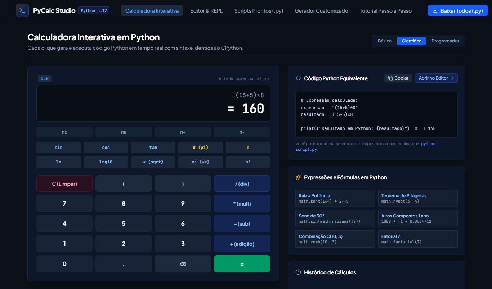

# PyCalc Studio - Calculadora Interativa em Python

Calculadora interativa criada com o Google AI Studio (Gemini) durante a Imersão Dev da Alura + Google.

## O que ela faz

- Três modos de calculadora: básica, científica e programador
- Mostra o código Python equivalente a cada cálculo
- Editor de código (REPL) para testar expressões
- 6 scripts Python prontos: terminal, funções, POO, científica, Tkinter e financeira
- Gerador de código de calculadoras Python personalizadas
- Tutorial passo a passo e histórico de cálculos

## Como rodar

1. Clone o repositório
2. Instale as dependências: `npm install`
3. Rode: `npm run dev`
4. Abra `http://localhost:3000`

Não é necessária chave de API.

## Tecnologias

React, TypeScript, Vite e Tailwind CSS.

Feito por Brayan Cesar de Castro.
